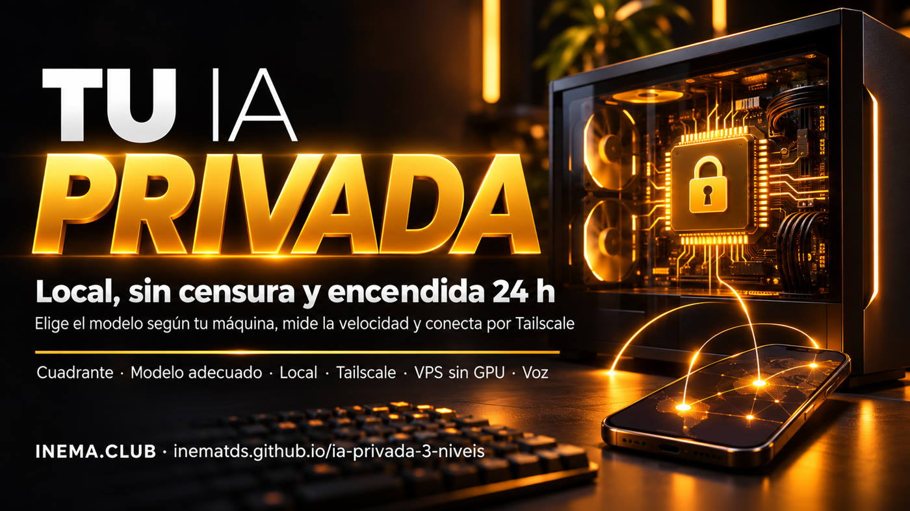

# IA privada en 3 niveles — tu IA, en tu máquina, conectada todo el tiempo

**🇧🇷 [Português](README.md) · 🇺🇸 [English](README.en.md) · 🇪🇸 [Español](README.es.md)**

## Qué es

Kit gratuito de INEMA para tener un modelo de IA que **no envía nada fuera** y que puedes usar desde el
celular, desde cualquier lugar. Elige el modelo adecuado para tu máquina (normal o sin censura), mide la
velocidad, comprueba que el puerto esté cerrado y muestra dos formas de mantener la IA siempre conectada:
la tarjeta gráfica de casa por Tailscale o un modelo pequeño en una VPS. Todo medido de verdad, con las
cifras en la guía.

## 📖 Guía de uso

**https://inematds.github.io/ia-privada-3-niveis/guia/es/**

## Los 3 niveles

| Nivel | Dónde se ejecuta el modelo | Qué pagas | Dónde está |
|---|---|---|---|
| 1 · API | servidor de otra empresa | por uso | kit [ia-sem-censura-defensiva](https://inematds.github.io/ia-sem-censura-defensiva/guia/es/) |
| 2 · Local | en tu computadora | electricidad y disco | [`kit/guias/2-local.md`](kit/guias/2-local.md) (en portugués) |
| 3 · Siempre conectada | GPU de casa por Tailscale (A) o VPS sin GPU (B) | nada (A) o la VPS (B) | [`kit/guias/3-sempre-ligada.md`](kit/guias/3-sempre-ligada.md) (en portugués) |
| + Voz | Jarvis Local con cerebro sin censura | nada | [`kit/guias/4-voz-jarvis.md`](kit/guias/4-voz-jarvis.md) (en portugués) |

Antes de empezar: [`kit/USO-RESPONSAVEL.md`](kit/USO-RESPONSAVEL.md) (en portugués) y el cuadrante
([`kit/guias/1-quadrante.md`](kit/guias/1-quadrante.md)) (en portugués).

## El proceso, de principio a fin

Quién lo hace: 🧠 tú en una sesión con el asistente · ⚙️ script del kit · 🤖 agente/modelo.

| # | Paso | Comando / archivo | Quién |
|---|---|---|---|
| 1 | Leer las reglas | [`kit/USO-RESPONSAVEL.md`](kit/USO-RESPONSAVEL.md) (en portugués) | 🧠 |
| 2 | Ejecutar las pruebas del kit (sin conexión) | `python3 -m unittest discover -s kit/testes -v` | ⚙️ |
| 3 | Decidir el cuadrante | `python3 kit/scripts/quadrante.py` | 🧠 + ⚙️ |
| 4 | Instalar Ollama | `curl -fsSL https://ollama.com/install.sh \| sh` (Linux) o instalador (Mac/Windows) | 🧠 / 🤖 con el [prompt 01](kit/prompts/01-instalar-e-escolher.md) (en portugués) |
| 5 | Elegir el modelo según la máquina | `python3 kit/scripts/escolhe_modelo.py` | ⚙️ |
| 6 | Descargar y medir | `ollama pull <modelo>` + `python3 kit/scripts/checa_local.py --modelo <modelo>` | ⚙️ |
| 7 | Comprobar el puerto | `python3 kit/scripts/checa_local.py --so-porta` → `loopback` | ⚙️ |
| 8a | Siempre conectada mediante la GPU de casa | `tailscale serve --bg --tcp 11434 tcp://127.0.0.1:11434` ([prompt 02](kit/prompts/02-casa-pelo-tailscale.md)) (en portugués) | 🤖, comprobado por 🧠 |
| 8b | Siempre conectada en una VPS sin GPU | [prompt 03](kit/prompts/03-vps-sempre-ligada.md) (en portugués) | 🤖, comprobado por 🧠 |
| 9 | Medir desde otro dispositivo | `checa_local.py --base-url http://100.x.y.z:11434 --modelo <modelo>` | ⚙️ |
| 10 | Voz (opcional) | cerebros de [`kit/config/jarvis-cerebros.exemplo.json`](kit/config/jarvis-cerebros.exemplo.json) en Jarvis Local | 🧠 |

## Requisitos

Python 3.10+ (solo biblioteca estándar), Ollama y, para el nivel 3, una cuenta gratuita de Tailscale. Para
la opción B, una VPS Ubuntu con 8 GB de RAM o más.

## Licencia

MIT: consulta [LICENSE](LICENSE).